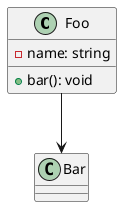

# tree-sitter-plantuml

[PlantUML](https://plantuml.com) grammar for [tree-sitter](https://tree-sitter.github.io/tree-sitter/).

## Install

### Neovim

See [docs/nvim.md](./docs/nvim.md)

### Node.js

```bash
npm install tree-sitter-plantuml
```

## Usage

```bash
# Parse a file
npx tree-sitter parse diagram.puml

# Generate parser
npm run generate

# Run corpus, bindings, and fixture smoke tests
npm test
```

## Supported Diagrams

Dedicated structured grammars:

| Family | Start token | Status |
|---|---|---|
| Class / object / use case / component / deployment | `@startuml` | structured |
| Sequence | `@startuml` | structured |
| Activity (beta) | `@startuml` | structured |
| State | `@startuml` | structured |
| Requirement | `@startuml` | structured |
| ArchiMate / C4 / stdlib macros | `@startuml` | macro calls + tags |
| Mindmap | `@startmindmap` | structured |
| WBS | `@startwbs` | structured |
| Gantt / project | `@startgantt`, `@startproject` | structured |
| Timing | `@starttiming` | structured |
| JSON / YAML / HCL | `@startjson`, `@startyaml`, `@starthcl` | body + injection + `#highlight` |
| nwdiag | `@startnwdiag` | structured |
| Salt | `@startsalt` | structured |
| Ditaa | `@startditaa` | body + text injection |
| Chen ER | `@startchen` | structured |
| Git log | `@startgit` | structured |
| Files tree | `@startfiles` | structured |
| Chronology | `@startchronology` | line-level |
| EBNF | `@startebnf` | structured |
| Regex | `@startregex` | structured |
| Packetdiag | `@startpacketdiag` | structured |
| Board / Wire / Flow / BPM | `@startboard`, `@startwire`, `@startflow`, `@startbpm` | structured / line-level |
| Math / LaTeX / Creole / DOT / sprites / chart | corresponding `@start...` | body + injection |

Any other `@startX ... @endX` block is accepted through `generic_diagram` with
a lossless `raw_body`, so unknown diagram types never produce `ERROR`.

## Queries

`queries/` contains the full editor query set:

`highlights`, `injections`, `folds`, `indents`, `locals`, `tags`,
`textobjects`, `context`, `rainbow`.

See [docs/queries.md](./docs/queries.md) for the capture contract.

## File Extensions

`.puml`, `.iuml`, `.plantuml`, `.wsd`, `.pu`

## Example



## Development

See [docs/dev.md](./docs/dev.md)
